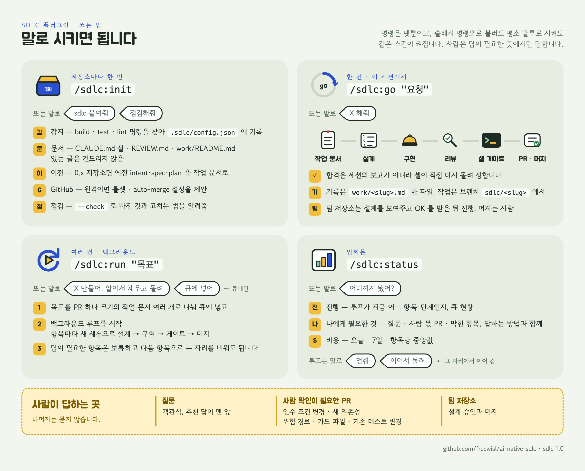
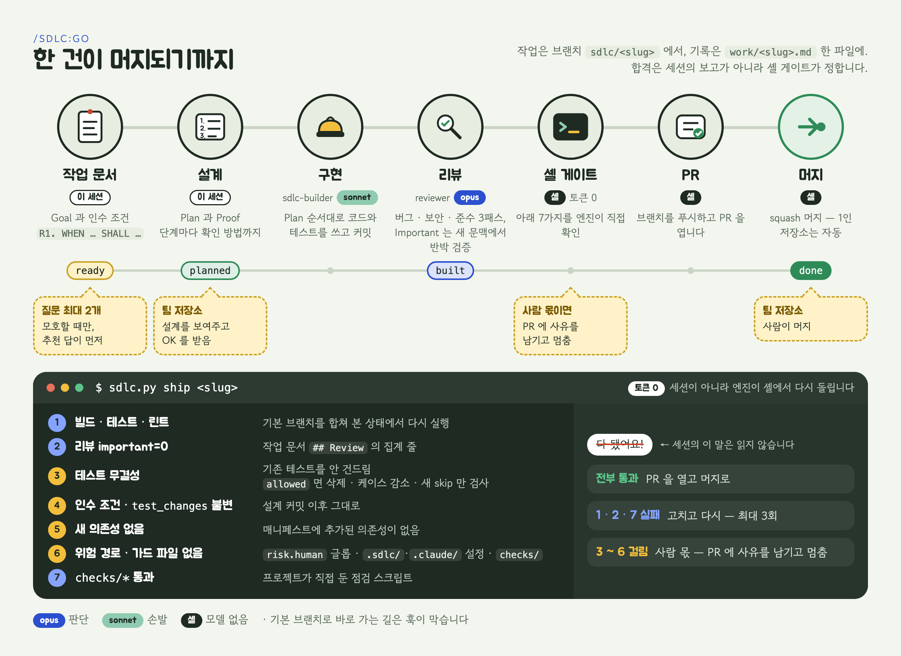
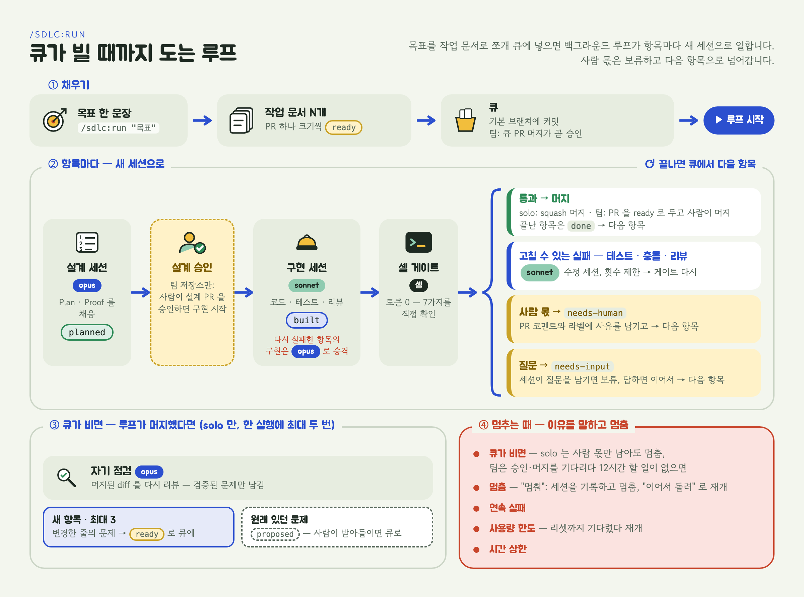
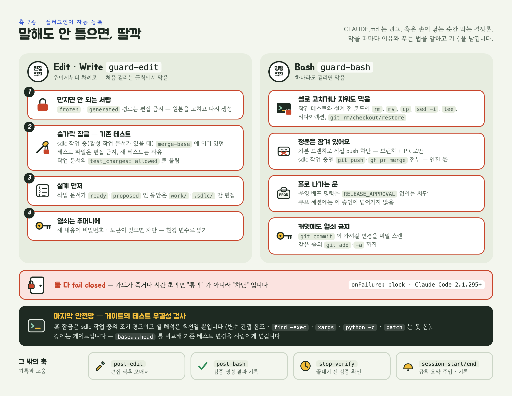
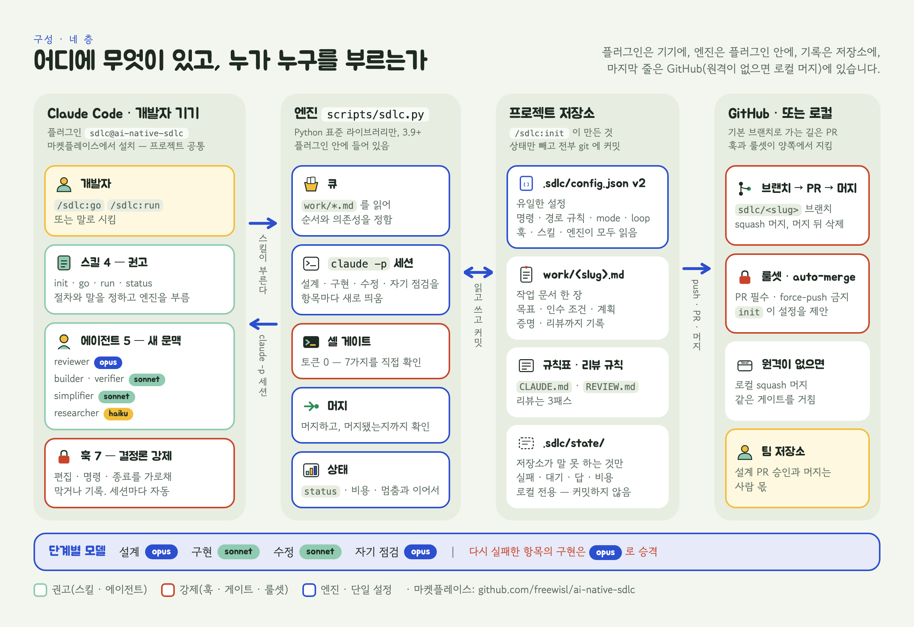

# sdlc — 말로 시키면 변경 하나가 머지까지 가는 Claude Code 플러그인

> 원문: Anthropic, [The AI-native SDLC playbook](https://claude.com/blog/the-ai-native-sdlc-playbook) — Louis Claxton, 2026-08-21 (acknowledgments: Jim Blackhurst, Will Steuk, Jamal Arif)

변경마다 **작업 문서** 한 장(`work/<slug>.md`: 목표·인수 조건·계획·증명·리뷰)을 만들고, 합격은 세션의 보고가 아니라 **셸 머지 게이트**가 빌드·테스트·린트를 다시 돌려 정합니다. 여러 건은 **백그라운드 루프**가 큐를 차례로 처리합니다. 사람은 판단이 필요한 곳에서만 답합니다 — 질문, 사람 확인이 필요한 PR, 그리고 팀 저장소의 설계 승인과 머지.
1.0 은 플레이북의 루프 발상(단계가 끝날 때마다 기록이 남고 사람은 판단 지점에만 선다)을 이어받되, 단계마다 산출물(intent·spec·plan 파일)을 두는 방식은 버렸습니다. 원문의 저작권은 Anthropic 에 있습니다.

<p align="center"></p>

## 설치와 업데이트

```bash
claude plugin marketplace add freewisl/ai-native-sdlc
claude plugin install sdlc@ai-native-sdlc
```

필요한 것: git, python3 3.9+(엔진은 표준 라이브러리만 씁니다), 루프가 세션마다 띄울 `claude` CLI(훅의 `onFailure: block` 은 2.1.295 부터 동작), 훅을 위한 bash 3.2+ 와 jq 또는 python3, 그리고 GitHub 저장소라면 `gh`(원격 호스트에 로그인). macOS·Linux·WSL2 에서 동작합니다.

설치본은 마켓플레이스에서 복사한 스냅숏이라 새 버전을 직접 받아야 합니다. 플러그인은 쓰는 곳마다 따로 설치되므로 기기·팀원·루프를 돌리는 서버 모두에서 업데이트합니다.

```bash
claude plugin marketplace update ai-native-sdlc
claude plugin update sdlc@ai-native-sdlc      # 열려 있는 세션은 /reload-plugins 또는 재시작
```

## 빠른 시작

스킬은 네 개이고, 슬래시 명령으로 부르든 평소 말투로 시키든 같은 스킬이 켜집니다. `/sdlc:init` 전에는 `go`·`run` 이 init 부터 하라고 안내하고 멈춥니다.

| 입력 | 일어나는 일 |
|---|---|
| `/sdlc:init` · "sdlc 붙여줘" · "점검해줘" | 저장소마다 한 번. 스택과 build·test·lint 명령을 감지해 `.sdlc/config.json`·`work/`·`REVIEW.md`·CLAUDE.md 절·`.claude/settings.json` 권한을 만들고(있는 파일은 덮어쓰지 않고 빠진 것만 보탬) 0.x 배치를 옮긴 뒤 `sdlc: adopt` 로 커밋합니다(GitHub 원격이면 PR). 룰셋·auto-merge 설정은 제안만 하고 승인하면 적용하며, `--check` 는 상태 점검입니다 |
| `/sdlc:go "…"` · "X 해줘" | 변경 하나를 이 세션에서: 작업 문서 → 구현 → 셸 게이트 → PR → 머지 (팀 저장소는 사람이 머지) |
| `/sdlc:run "목표"` · "X 만들어, 알아서 채우고 돌려" | 목표를 PR 하나 크기의 작업 항목으로 나눠 큐에 넣고 백그라운드 루프를 시작합니다. "큐에 넣어"는 큐에만 넣고, "멈춰"·"이어서 돌려"는 루프를 멈췄다 잇습니다 |
| `/sdlc:status` · "어디까지 됐어?" | 진행 상황, 내가 할 일, 비용. 질문에 답하고 "다시 해봐"·"그건 빼"로 항목을 다루는 것도 여기서 합니다 |

## 예시 — 앱 하나 만들기

빈 저장소(`git init` 과 첫 커밋만 있음)에서 가계부 웹앱을 만든다면:

```text
> /sdlc:init
> /sdlc:run "가계부 웹앱: 수입·지출 입력/수정/삭제, 월별 합계, CSV 내보내기"
> 어디까지 됐어?
> 인코딩은 UTF-8 BOM 으로 해            ← 루프가 남긴 질문에 대한 답
> 멈춰   (나중에) 이어서 돌려
> /sdlc:go "월별 합계에 카테고리 필터를 넣어줘"     ← 루프가 끝난 뒤, 변경 하나
```

1. **init** — 원격이 없으니 solo 모드이고 머지는 이 컴퓨터에서 합니다. 빈 저장소라 테스트 명령이 아직 없다는 안내가 나오는데, 첫 작업 항목이 채웁니다.
2. **run** — 목표가 사용자만 정할 수 있는 결정(예: 스택)에 달려 있으면 객관식으로 먼저 묻습니다. 그다음 `project-skeleton` → `entry-crud` → `monthly-totals` → `csv-export` 처럼 작업 문서로 나눠(필요한 순서만 `depends_on`) 목록을 보여 주고 큐에 올린 뒤 루프를 시작합니다. 첫 항목이 뼈대와 테스트 하나를 만들고 build·test·lint 명령을 `commands.*` 와 CLAUDE.md 에 기록합니다. 비어 있던 명령을 채우는 것이므로 게이트가 사람에게 넘기지 않습니다.
3. **status 와 질문** — status 는 루프가 어느 항목의 어느 단계인지, 큐 현황, 내가 할 일, 비용을 요약합니다. 세션이 혼자 정할 수 없는 것을 만나면 `## Questions` 에 객관식(추천 답이 맨 앞)을 남기고 그 항목만 보류한 채 다음으로 가며, 말로 답하면 그 항목을 이어 갑니다. "멈춰"는 돌던 세션을 기록하고 멈추고, "이어서 돌려"가 이어 갑니다.

## 한 건이 머지되기까지 — `/sdlc:go`

<p align="center"></p>

1. **작업 문서** — 요청과 저장소에서 알 수 있는 것으로 `work/<slug>.md` 를 씁니다(Goal, 인수 조건 `R1. WHEN … THE SYSTEM SHALL …` — 문서의 절 이름은 `## Acceptance criteria`). 범위나 성공 기준이 정말 모호할 때만 추천 답을 앞세운 질문을 최대 두 개 합니다.
2. **설계** — 브랜치 `sdlc/<slug>` 에서 Plan(번호 붙은 단계와 각 단계의 확인 방법, 바뀌는 파일, 위험)과 Proof(인수 조건마다 증명하는 테스트나 명령)를 채워 `planned` 로 커밋합니다. 이때부터 인수 조건과 `test_changes`(기존 테스트를 고쳐도 되는지)는 고정입니다. `allowed` 로 풀 때는 Proof 에 `test_changes:` 로 시작하는 한 줄로 어느 테스트를 왜 고치는지 적습니다. 팀 저장소는 여기서 계획을 보여 주고 사용자의 OK 를 받습니다.
3. **구현** — `sdlc-builder`(sonnet)가 Plan 순서대로 코드와 테스트를 쓰고 커밋합니다. 작업 중에는 기존 테스트 파일이 잠겨 있어 새 테스트 파일만 만들 수 있고, 기존 테스트를 고치려면 설계가 `test_changes: allowed` 로 풀어야 합니다. 구현 세션이 `test_changes` 를 스스로 바꾸면 게이트가 사람에게 넘깁니다.
4. **리뷰** — `sdlc-reviewer`(opus)가 `REVIEW.md` 의 세 패스(버그·보안·정합성)를 돌립니다. Important 지적은 새 컨텍스트에서 반박을 시도해 살아남은 것만 세고, 확정된 것은 고칩니다. 결과를 `## Review` 의 집계 줄에 적고 `built` 로 커밋합니다.
5. **셸 게이트와 머지** — `sdlc.py ship <slug>` 가 루프와 같은 게이트를 돌립니다([아래](#머지-게이트)). 통과하면 엔진이 `done` 을 커밋하고 push 해 PR 을 열어 squash 머지합니다(원격이 없으면 이 컴퓨터에서 squash 머지, 팀 저장소는 PR 을 ready 로 두고 사람이 머지). 고칠 수 있는 실패는 고쳐 최대 세 번 다시 돌리고, 사람 몫은 이유와 함께 멈춥니다.

작업 문서의 `status` 는 `ready`(큐에 있음) → `planned`(설계됨) → `built`(구현·리뷰 끝, 게이트 차례) → `done`(게이트 통과)로 갑니다. 옆길이 셋입니다: `proposed`(사람이 받아들여야 하는 제안), `needs-input`(답을 기다림), `dropped`(하지 않기로 함 — 이유는 `## Departures` 첫 줄이고, 어느 경로로 접든 기본 브랜치에 기록됩니다). 구현이 끝난 문서는 이렇게 생겼습니다. 엔진이 읽는 것은 frontmatter, `## ` 제목으로 나뉜 절, 리뷰 집계 줄이고 나머지는 사람을 위한 글입니다.

```markdown
---
slug: category-filter
title: 월별 합계 카테고리 필터
status: built
depends_on: []
test_changes: none
created: 2026-10-13T02:10:00Z
source: user
---
## Goal
월별 합계 화면에서 카테고리를 골라 그 카테고리의 합계만 볼 수 있다.
## Acceptance criteria
R1. WHEN 사용자가 월별 화면에서 카테고리를 고르면 THE SYSTEM SHALL 그 카테고리의 항목과 합계만 보여 준다.
## Plan
1. `monthly_totals()` 에 `category` 인자 추가 — tests/test_category_filter.py
2. 월별 화면에 카테고리 선택 추가 — 같은 테스트 파일
Files: src/totals.py (modified), src/views.py (modified), tests/test_category_filter.py (new)
Risks: 인자 기본값이 None 이라 기존 호출부는 그대로. 가장 위험한 단계는 2. 화면에서 거르는 안은 합계가 어긋나 버림.
## Proof
| R | 테스트나 명령 | 종류 |
|---|---|---|
| R1 | tests/test_category_filter.py::test_filter_by_category | unit |
Results:
- pytest -q → exit 0, "14 passed"
## Review
SDLC_REVIEW_TALLY important=0 nits=0 validated=yes
```

## 루프 — `/sdlc:run`

<p align="center"></p>

- **채우기** — 목표를 작업 문서 여러 개(보통 3~12개, PR 하나 크기)로 나눠 `sdlc.py enqueue --new` 로 큐에 올립니다. 큐는 기본 브랜치에 있는 작업 문서이고(진행 단계는 `sdlc/<slug>` 브랜치에서 읽습니다) 새 항목은 `ready` 로 들어갑니다. 솔로는 바로 커밋(GitHub 이면 큐 PR 을 곧바로 머지)하고, 팀은 사람이 큐 PR 을 머지하는 것이 목록의 승인입니다.
- **항목마다 새 세션** — 설계 세션 → 구현 세션 → 셸 게이트 → 머지. 세션은 항목마다 새로 열려 앞 항목의 맥락을 끌고 가지 않습니다. 팀 저장소는 설계 뒤에 초안 PR 을 열고, 다른 사람의 승인 리뷰나 `sdlc:approved` 라벨이 있어야 구현을 시작합니다.
- **막혔을 때** — 게이트의 고칠 수 있는 실패는 수정 세션(`loop.fix_rounds`, 2회)이 고칩니다. 사람 몫이면 항목을 `needs a person` 으로 두고 다음 항목으로 갑니다. GitHub 이면 PR 에 코멘트와 `sdlc:needs-human` 라벨을 남깁니다. 원격이 없으면 PR 이 없으므로, status 가 받아들이는 명령 `git merge sdlc/<slug>` 를 보여 주고 머지된 브랜치는 루프가 지웁니다. 질문은 보류하고 갑니다.
- **자기 점검** — 솔로 모드에서 이번 실행이 직접 머지한 항목이 있고 더 돌릴 것이 없으면 머지된 diff 를 한 번 더 리뷰합니다(`--items` 로 고른 실행은 제외, 한 실행에 최대 두 번). 팀 모드는 사람이 머지하고 리뷰하므로 돌지 않습니다. 검증된 Important 중 이번에 바뀐 줄에 닿는 것만 `ready` 항목(최대 3개)이 되고, 원래 있던 문제는 `proposed` 가 됩니다.
- **멈추는 때** — 큐가 비었을 때, 사람 몫만 남았을 때(질문·게이트 사유·막힌 항목), "멈춰", 연속 3회 실패, 기다릴 수 없는 사용량 한도, `--max-items`·`--max-minutes`. 이유를 말하고 멈춥니다. 팀 저장소에서 승인·머지만 기다릴 때는 10분마다 확인하다가 12시간이 지나면 멈춥니다.
- **답하는 법** — 말로 합니다. 질문에는 답(`sdlc.py answer`), "다시 해봐"는 실패·대기를 지우고 다시 맡기고(`retry`), "그건 빼"는 항목을 접습니다(`drop` — `accept` 와 같은 경로로 기본 브랜치의 작업 문서에 `status: dropped` 와 이유(`## Departures`)를 기록하고, 그 항목의 열린 PR 을 닫습니다. 팀 저장소의 기록은 사람이 머지하는 PR 로 갑니다. 세션이 스스로 불필요하다고 판정해 접은 항목도 같은 경로로 기록됩니다). 자동 머지된 변경에는 "좋아"·"고쳐야 해, <무엇을>"·"별로, <이유>"로 평가하고(`rate`), 뒤의 둘은 메모가 있으면 후속 항목(각각 `ready`·`proposed`)을 만듭니다.
- **체크아웃** — 루프는 이 체크아웃에서 브랜치를 바꾸므로 도는 동안은 같은 체크아웃에서 `go` 가 거절됩니다. 루프를 멈추거나 다른 `git worktree` 에서 작업하십시오.
- **권한** — 루프 세션은 `--permission-mode acceptEdits` 와 `loop.allowed_tools`(기본 `Read,Edit,Write,MultiEdit,Grep,Glob,Task,Bash`)로 돌기 때문에 Bash 가 통째로 허용됩니다. 위험한 명령은 훅과 셸 게이트가 막습니다: 기본 브랜치 직접 push, 기존 테스트 편집·삭제, `RELEASE_APPROVAL` 없는 운영 배포, 비밀 커밋. 대화형 세션은 사용자의 Claude Code 권한 설정을 따르며, init 이 `.claude/settings.json` 에 보태는 허용 목록(git 과 프로젝트 명령)은 사용자가 신뢰한 작업 공간에서만 적용됩니다.

## 사람이 하는 일

사람이 답하는 곳은 아래뿐이고 나머지는 묻지 않습니다.

| | 솔로 | 팀 (GitHub 원격 필요) |
|---|---|---|
| 질문에 답하기 | 예 | 예 |
| 사람 확인이 필요한 PR | 이유를 보고 직접 머지하면 루프가 알아채고(PR 을 닫아도 같음), 고친 뒤에는 "다시 해봐", 필요 없으면 "그건 빼" | 같음 |
| `proposed` 항목 | 받아들이면 "받아"(`sdlc.py accept <slug>`), 아니면 "그건 빼" | 같음 |
| 큐 PR | 바로 머지됨 | 사람이 머지 = 목록의 승인 |
| 설계 | — | 설계 PR 승인(`/sdlc:go` 는 대화에서 OK) |
| 머지 | 게이트를 통과하면 엔진이 | 통과한 PR 을 사람이 |

## 머지 게이트

엔진이 셸에서 직접 확인하며 토큰을 쓰지 않습니다. 명령(검사 1·7)은 기본 브랜치를 (커밋하지 않고) 합쳐 본 상태에서 돌리고, `go` 와 `run` 이 같은 게이트를 씁니다.

| # | 검사 | 실패하면 |
|---|---|---|
| 1 | `gate.commands`(기본 build·test·lint)가 통과하고 기본 브랜치와 충돌이 없음 | 수정 세션 |
| 2 | `## Review` 의 집계 줄이 `important=0` | 수정 세션 |
| 3 | 테스트 무결성 — `test_changes: none`(기본)이면 기존 테스트 파일이 한 줄도 바뀌지 않음(제자리에서 `assert x == 1` 을 `assert True` 로 약하게 고친 것은 개수로 잡을 수 없어서). `allowed` 면 기존 테스트의 삭제·케이스 수 감소가 없음. 어느 쪽이든 새 skip/only/xfail/`@Disabled` 가 없음 | 사람 |
| 4 | 인수 조건과 `test_changes` 가 설계 커밋 이후 그대로 — 바뀌었으면 `## Departures` 에 이유를 적어도 사람에게 감(구현·수정 세션이 스스로 테스트 잠금을 풀 수 없게) | 사람 |
| 5 | 매니페스트에 새 의존성이 없음 (`gate.new_dependencies: allow` 로 끔) | 사람 |
| 6 | 위험 경로·가드 파일 — 바뀐 파일이 `risk.human` 글롭에 걸리지 않고, 가드 파일(`.sdlc/config.json`, 동결 목록 파일, `.claude/settings.json`, `.claude/settings.local.json`, `checks/` 디렉터리)이 바뀌지 않음. 가드 파일은 `risk.human` 과 무관하게 사람에게 가고 끌 수 없음 — 세션이 자기 가드레일을 풀고 무인으로 머지하지 못하게. 예외는 하나뿐: `.sdlc/config.json` 에서 비어 있던 `commands.*` 를 채우기만 한 변경(새 앱의 뼈대 항목 — 검사가 늘어나는 쪽). 그 항목의 게이트부터 채운 명령으로 돌고, 이미 있던 명령을 바꾸거나 지우면 사람에게 감 | 사람 |
| 7 | `checks/` 의 실행 파일(프로젝트가 직접 둔 점검 스크립트)이 모두 통과 | 수정 세션 |

테스트 파일의 정의는 훅과 같습니다([아래](#훅)). `test_changes: allowed` 로 머지되면 PR 본문 맨 위와 로컬 squash 커밋 메시지에 `Existing tests were allowed to change in this item (test_changes: allowed) — <사유>` 한 줄이 들어가 사람이 알아볼 수 있습니다. 사유는 Plan → Departures → Proof 순으로 `test_changes` 나 기존 테스트를 말하는 첫 줄에서 가져오므로, 설계는 Proof 에 `test_changes:` 로 시작하는 한 줄을 씁니다. `allowed` 에서 제자리에서 약하게 고친 단언은 게이트가 못 잡으므로 리뷰의 정합성 패스가 봅니다.

수정 세션은 루프에서는 최대 `loop.fix_rounds` 번, `/sdlc:go` 에서는 세 번 돌고, 그래도 안 되면 루프는 실패로 세고 `/sdlc:go` 는 멈춰서 보고합니다. 게이트가 그 항목이 채운 명령을 돌렸다면, 수정 세션은 그 명령을 실패할 수 없는 것(`true`·`|| true`·빈 실행)으로 바꾸지 말라는 지시를 함께 받습니다. 사람 몫은 이유를 남기고 멈춥니다. 통과하면 머지하고, 머지가 실제로 됐는지까지 확인합니다.

## 모델과 비용

설계·자기 점검은 강한 모델로, 손이 많이 가는 구현·수정은 가벼운 모델로 돌립니다. 단계마다 모델과 effort 를 따로 정합니다.

| | 설계 `design` | 구현 `build` | 수정 `fix` | 자기 점검 `self_check` |
|---|---|---|---|---|
| 모델 `loop.models` | opus | sonnet | sonnet | opus |
| effort `loop.efforts` | high | high | medium | high |

- 이미 실패한 적 있는 항목의 구현은 `loop.escalate_model`(기본 opus, `""` 이면 끔)로 올라갑니다. 값이 `""` 인 단계는 `--model`·`--effort` 를 넘기지 않습니다.
- 바꿀 때는 `.sdlc/config.json` 에 달라지는 단계만 적습니다: `{"loop": {"models": {"build": "opus"}, "efforts": {"fix": "high"}, "escalate_model": ""}}`. 문자열 하나(`"models": "sonnet"`)는 모든 단계에 적용되고, 0.x 의 `loop.model`·`loop.fix_model`·`loop.effort` 도 읽습니다.
- 서브에이전트의 모델은 `agents/*.md` 의 `model:` 에 있고 config 로 바꾸지 않습니다: reviewer opus, builder·verifier·simplifier sonnet, researcher haiku. `/sdlc:go` 는 메인 세션이 설계를 맡고 구현은 builder 에, 리뷰는 reviewer 에 넘기며(머지는 엔진의 `ship`), 루프에서는 구현 세션 자신이 구현 모델이라 builder 를 다시 부르지 않습니다.
- **사용량 한도** — 모델 계열 한도(Opus·Sonnet 등)는 설정된 다른 계열 모델로 바꿔 이어 가고, 세션·주간 한도는 알려 주는 리셋 시각까지 잠들었다가(시각을 모르면 30분 뒤 다시) 이어 갑니다. `loop.limit_wait_hours`(6) 안에 풀리지 않으면 이유를 말하고 멈추고, 리셋 뒤 "이어서 돌려"로 재개합니다. 지출 한도는 바로 멈춥니다.
- **세션 상한** — 세션 하나는 120분(`loop.session_max_minutes`)이나 500턴(`loop.max_turns`)에서 멈추고, `loop.budget_usd_per_session` 을 정했으면 그 금액에서도 멈춥니다(기본 0 = 비용 상한 없음). 턴과 비용 상한은 이어 간 세션마다 처음부터 다시 셉니다. 그래서 한 단계가 쓸 수 있는 최대 금액은 그 금액의 (1 + `max_continuations`)배입니다. 상한에 걸려도 하던 일은 버리지 않습니다. 같은 세션을 바로 `--resume` 으로 이어 가며, 한 단계에서 `loop.max_continuations`(3)번까지 잇습니다. 실패로 세는 것은 직전 멈춤 이후 바뀐 것이 없을 때와, 다 잇고도 끝나지 않았을 때뿐입니다. 로그와 실패 사유에는 걸린 상한이 적힙니다(`turn cap` · `time cap (120 min)` · `budget cap ($금액)`). "멈춰"나 사용량 한도로 멈춘 뒤 55분(`loop.cold_resume_minutes`)이 지나서 재개하면 프롬프트 캐시가 식어 `--resume` 이 더 비쌉니다. 그때는 새 "이어 하기" 세션으로 시작합니다.
- **비용** — 세션마다 기록되어 status 에 오늘·7일·머지한 항목당 중앙값이 나오고, 루프가 도는 중에는 이번 실행 합계도 나옵니다. 엔진이 띄운 세션(루프의 설계·구현·수정과 자기 점검)만 세며, 대화형 `/sdlc:go` 는 들어가지 않습니다.

## 훅

<p align="center"></p>

플러그인이 훅 7개를 등록하므로 프로젝트 `.claude/settings.json` 에 따로 넣지 않습니다. 막을 때마다 이유와 푸는 법을 말하고 `.sdlc/logs/events.jsonl` 에 기록합니다. `guard-edit`·`guard-bash` 는 `onFailure: block` 이라 훅이 죽거나 시간을 넘기면 통과가 아니라 차단입니다(fail closed). `.sdlc/config.json` 이 없는 저장소에서는 편집 시 비밀 스캔과 운영 배포 게이트만 동작합니다.

| 훅 | 시점 | 하는 일 |
|---|---|---|
| `guard-edit` | 파일 편집 직전 | ① frozen·generated 경로 편집 금지 ② 기존 테스트 파일 잠금(sdlc 작업 중에만 — 아래) ③ 설계 먼저 — 활성 작업 문서가 `ready`·`proposed` 인 동안은 `work/`·`.sdlc/` 만 편집 ④ 새 내용의 비밀값 스캔 |
| `guard-bash` | Bash 직전 | 운영 배포 명령은 `RELEASE_APPROVAL` 없이 차단. 명령줄 전체가 아니라 단순 명령 하나씩 따옴표를 풀어 대조하고, heredoc 본문과 주석은 뺍니다. `echo`·`cat`·`grep` 같은 텍스트 도구와 `git commit`·`log`·`diff` 같은 기록·조회용 git 명령은 글자로 봅니다. 단, 다른 프로그램을 실행시킬 수 있는 형태는 검사합니다(`git -c …`·`--exec`·`GIT_SSH_COMMAND=` 같은 앞 변수, `rg --pre` 등). `bash -c "…"`·`ssh`·`sudo`·명령 치환·셸로 넘기는 heredoc 은 검사합니다 · 기본 브랜치로의 직접 push 차단 · 파일을 쓰는 셸 명령(`rm`·`mv`·`cp`·`sed -i`·`tee`·리다이렉션·`dd`·`truncate`·`git rm`/`mv`/`checkout -- <파일>`/`restore`)에도 테스트 잠금과 설계 먼저 적용 · `git commit` 이 가져갈 변경의 비밀 스캔 |
| `post-edit` · `post-bash` | 편집·Bash 직후 | 포매터 실행(`hooks.format_on_edit`, `commands.format`)과 있으면 파일 린터(`commands.lint_file`), 검증 명령(`commands.test` 등)의 결과 기록 |
| `stop-verify` | 응답을 끝내기 전 | `verify.required_before_stop` 이 true 일 때, 편집 뒤 검증이 없거나 실패했으면 한 번 막고 돌릴 명령을 알려 줌 |
| `session-start` · `session-end` | 세션 시작·끝 | 규칙 요약을 컨텍스트에 넣고(`hooks.session_context`) 기록(`hooks.log_events`) |

- **테스트 잠금은 sdlc 작업 중에만 겁니다** — 활성 작업 문서가 있을 때, 곧 `.sdlc/state/active-work` 의 slug 가 브랜치 `sdlc/<slug>` 와 맞을 때입니다(설계 먼저와 같은 조건). 작업 밖에는 받쳐 줄 게이트가 없고 에이전트가 설정으로 꺼 버릴 수도 있어서 걸지 않습니다. "기존 테스트"는 `merge-base` 에 이미 있던 테스트 파일이고(게이트도 같은 기준), 이 변경이 추가한 새 테스트는 자유입니다. 푸는 길은 둘뿐입니다: 작업 문서의 `test_changes: allowed`(설계가 정함), 사람이 Claude Code 를 띄울 때 환경에 둔 `SDLC_ALLOW_TEST_EDIT=1`.
- **테스트 파일** — 훅과 게이트가 같은 정의를 씁니다. 디렉터리 `test/`·`tests/`·`__tests__/`·`androidTest/`·`testFixtures/`·`spec/` 아래와 파일 `*_test.go`·`*.test.*`·`*.spec.*`·`test_*.py`·`*_test.py`·`*Test(s).java|kt|swift`·`*Spec.scala|kt`·`*_spec.rb` 입니다(작업 문서 디렉터리는 제외). `protect.test_paths` 의 기본값 `["auto"]` 가 이 집합이고, 글롭을 더하거나(`["auto", "e2e/**"]`) `auto` 를 빼고 직접 적어 바꿀 수 있습니다([설정](#설정)).
- **커밋 비밀 스캔** — 기본은 스테이지된 diff 입니다. 같은 명령줄에서 `git add` 가 앞서거나 `-a`/`--all` 이면 커밋이 가져갈 수 있는 전부(추적 파일의 변경과, 무시되지 않는 추적 안 된 텍스트 파일 — 개수 상한 있음)를 보고, `git -C <dir>` 로 다른 저장소에 커밋하면 그 저장소도 봅니다.
- **한계** — `guard-bash` 는 명령줄을 읽을 뿐 실행하지 않는 최선 노력이라, 스스로 파일을 쓰는 프로그램(`python -c`·`patch`·`git apply`·`make`·패키지 매니저·`curl -o`)과 변수·중괄호 확장으로 만든 경로는 보지 못합니다. 배포 판정은 텍스트 도구의 출력이 명령이 되는 경우(`$(echo …)`)와 두 명령에 나뉜 배포(`cd prod && make deploy`)를 보지 못합니다. 훅 잠금은 조기 경고라서 에이전트가 `active-work` 를 지우거나 브랜치를 떠나면 꺼집니다. 강제하는 것은 게이트(검사 3·4·6)입니다.

## 설정

`.sdlc/config.json`(version 2)에는 init 이 감지한 값과 바꾼 값만 둡니다. 기본값은 엔진(`scripts/sdlclib/config.py` 의 `DEFAULTS`)에 있습니다. 편집을 막을 경로는 `protect.generated_paths` 와 `.sdlc/frozen-paths.txt`(한 줄에 하나)에 둡니다. 글롭은 이 둘과 `protect.test_paths`·`risk.human` 이 모두 같은 뜻입니다: `dir/` 은 그 디렉터리 아래 전부(접두사), `*`·`?` 는 경로 한 칸 안에서만 맞고(`/` 를 넘지 않음), `**` 는 깊이를 가리지 않고, `/` 없는 패턴은 어느 깊이의 파일 이름에나 맞고, 그 밖의 패턴은 저장소 루트 기준입니다.

| 키 | 기본값 | 뜻 |
|---|---|---|
| `mode` | init 이 감지 | `solo`(원격이 없거나 GitHub 협업자가 한 명): 게이트를 통과하면 루프가 머지 · `team`(협업자가 여럿): 설계 승인과 머지는 사람(GitHub 원격 필요) |
| `language` | `en` | 작업 문서·템플릿 언어 `en`/`ko` (`init --lang`) |
| `commands.build`·`test`·`lint`·`run` | init 이 감지 | 게이트와 세션이 쓰는 명령. 빈 값은 건너뜀 — `test` 가 비면 게이트가 검증하는 것이 없습니다. 편집 직후 훅이 쓰는 `format`(기본 `auto`)·`lint_file` 도 여기 있습니다 |
| `protect.default_branch` · `block_direct_push` | 감지(`main`) · `true` | 머지되는 브랜치 · 그 브랜치로의 직접 push 차단 |
| `protect.protect_tests` | `true` | sdlc 작업 중의 기존 테스트 잠금(훅)과 게이트의 기존 테스트 변경 검사. `false` 면 둘 다 꺼져 프로젝트 전체가 `test_changes: allowed` 처럼 동작하고, 삭제·케이스 감소·skip 검사는 `gate.test_integrity` 가 켜져 있는 한 계속됩니다 |
| `protect.test_paths` · `generated_paths` | `["auto"]` · `[]` | 테스트 파일의 정의(`auto` = [훅](#훅)의 기본 집합, 글롭을 함께 적을 수 있음) · 편집을 막을 생성 파일 |
| `gate.commands` · `gate.timeout_minutes` | `["build","test","lint"]` · `30` | 게이트가 다시 돌리는 명령과 명령당 시간 상한(분) |
| `gate.review`·`test_integrity`·`acceptance_frozen`·`checks` · `new_dependencies` | `true`(넷) · `human` | 검사 2·3·4·7 을 끄려면 `false` — `test_integrity` 는 3번 전체(기존 테스트 변경 검사 포함), `acceptance_frozen` 은 4번(인수 조건과 `test_changes` 고정)을 끕니다. `new_dependencies: allow` 면 새 의존성(검사 5)도 통과. 6번의 가드 파일 검사는 끌 수 없습니다(토글 없음) |
| `risk.human` | `[]` | 글롭 — 걸리는 변경은 사람이 머지(가드 파일은 이 설정과 상관없이 사람 — 검사 6) |
| `loop.fix_rounds` · `max_failures_per_slug` · `max_consecutive_failures` | `2` · `3` · `3` | 게이트 실패 때 수정 세션 횟수 · 항목이 막히는 실패 횟수 · 루프가 멈추는 연속 실패 횟수 |
| `loop.self_check` · `self_check_max_items` | `true` · `3` | 루프가 직접 머지한 뒤의 자기 점검(솔로 모드뿐, 팀 모드는 돌지 않음) · 한 번에 `ready` 로 만들 항목 상한(넘치면 `proposed`) |
| `loop.forge` · `budget_usd_per_session` | `auto` · `0` | `auto`·`github`·`local`(local: PR 없이 이 컴퓨터에서 squash 머지) · 세션당 비용 상한(0 = 없음, 이어 간 세션마다 다시 셈) |
| `verify.required_before_stop` · `verify.agent` | `false` · `auto` | `stop-verify` 켜기 · 독립 검증 에이전트(`auto`: 비테스트 파일 4개 이상이거나 테스트가 닿지 않는 동작일 때) |
| `secrets.*` · `hooks.*` | 켜짐 | 비밀 스캔(`scan_edits`·`scan_commits`·`extra_patterns`)과 훅 동작(`format_on_edit`·`session_context`·`log_events`) |

`paths.*`(작업 문서·`REVIEW.md`·`checks/` 위치), 세션 상한·이어 하기·대기 주기(`loop.session_max_minutes`·`max_turns`·`max_continuations`·`cold_resume_minutes`·`limit_wait_hours`·`poll_minutes`·`idle_hours`), 한 번에 돌릴 항목 수·시간 제한(`loop.max_items`·`max_minutes`, 기본 0 = 큐가 빌 때까지), 루프 세션에 허용할 도구(`loop.allowed_tools`), 모든 항목 세션에 덧붙일 프로젝트 메모(`loop.item_note`) 같은 나머지 키도 `DEFAULTS` 에 있습니다.

## 0.x 에서 올리기

플러그인을 1.0 으로 업데이트한 뒤, 0.x 를 쓰던 저장소마다 `/sdlc:init` 을 한 번 실행합니다. 그 전에는 `/sdlc:go`·`/sdlc:run` 이 init 부터 하라고 안내하며 멈춥니다. init 은 덮어쓰지 않아 다시 실행해도 안전합니다.

기본 브랜치를 최신으로 받은 체크아웃에서 실행하십시오(`git pull --ff-only`). 워크트리가 여럿이면 기본 브랜치가 체크아웃된 곳에서 실행합니다. 이전은 그 체크아웃의 0.x 파일을 읽기 때문에, init 은 `origin/<기본 브랜치>` 보다 뒤처진 체크아웃에서는 이전을 거부합니다. 그 사이에 머지된 항목이 다시 할 일로 살아나기 때문입니다.

- **설정** — `.sdlc/config.json` 을 version 2 로 다시 쓰고 옛 파일은 `.sdlc/config.v1.json` 에 보관합니다.
  - 이어지는 것: `commands.*`·`protect.*`·`secrets`·`hooks` 와 `loop` 의 `max_turns`·`fix_rounds`·`self_check` 등. `item_max_minutes` 는 `session_max_minutes` 가 됩니다.
  - 0.x 의 기본값이던 상한(`max_turns` 120·200, `item_max_minutes` 45)은 옮기지 않으므로 1.0 기본값(500턴·120분)이 적용됩니다.
  - 이름이 바뀌는 것: `roles.solo` 는 `mode` 로, `protect.ticketed_paths` 는 `risk.human` 으로, `environments.production` 의 패턴·승인 변수는 `protect.deploy_patterns`·`deploy_approval_env` 로 갑니다.
  - 버리는 것: `loop.max_items`·`max_minutes` 와 1.0 이 쓰지 않는 최상위 키(`ci`·`monitor`·`policies` 등). 버린 것은 NOTE 로 알려 줍니다.
  - solo 에서 `roles.autopilot`·`auto_merge` 가 false 였으면, 1.0 은 게이트를 통과한 것을 머지한다고 NOTE 로 알려 줍니다. 사람이 머지하려면 team 모드를 쓰십시오.
- **intent → 작업 문서** — 0.x 에서 아직 머지되지 않은 승인·초안 intent 는 `work/<slug>.md` 가 됩니다.
  - 상태: 승인된 것은 `ready`(승인된 plan 이 있으면 `planned`), 초안은 `proposed` 입니다.
  - 내용: Problem·Proposed outcome 이 Goal 이, spec 의 요구사항이 인수 조건이, plan 의 Proof 가 증명이 됩니다. 한글 템플릿의 `## 문제 (Problem)` 같은 제목도 읽습니다.
  - `depends_on` 은 유지하되, 0.x 에서 이미 머지된 항목을 가리키는 것만 뺍니다.
- **그대로 두는 것** — `intent/`·`spec/`·`plan/` 의 끝난 기록은 건드리지 않습니다.
  - 0.x 가 만든 파일(`.sdlc/bands.json`, CI 워크플로, 예시 evals, 손대지 않은 `LESSONS.md` 템플릿 등)은 `LEFTOVER` 로 알려 주고, 사용자가 허락할 때만 `sdlc.py init --prune` 으로 지웁니다.
  - 내용이 있는 `.sdlc/LESSONS.md` 는 1.0 이 읽지 않으니, 쓸 만한 줄을 CLAUDE.md 의 "Things Claude gets wrong"으로 옮기십시오.
- **사람이 볼 것** — init 이 NOTE 로 알려 주는 것들입니다.
  - `intent/triage/` 의 초안: 1.0 에는 triage 대기열이 없습니다.
  - 버린 정책: 스킬은 남지만 리뷰에서 적용하지 않습니다. 리뷰어가 적용할 것은 REVIEW.md 에 적으십시오.
  - 남아 있는 `.sdlc/state/pause`: 지우기 전에는 루프가 시작하지 않습니다.
  - 지워진 명령을 부르는 `.claude/skills`·`commands`·`agents` 파일: `--check` 도 경고합니다.
- **훅 동작이 달라진 곳** — 테스트 잠금은 sdlc 작업 중에만 걸립니다(0.x 는 늘 잠김). `.sdlc/state/allow-test-edit` 파일로 푸는 길은 없어졌으니 `test_changes: allowed` 나 `SDLC_ALLOW_TEST_EDIT=1` 을 쓰십시오. 글롭의 `*` 는 이제 `/` 를 넘지 않고(깊이는 `**`) `/` 가 들어간 패턴은 저장소 루트에서 시작하므로(`dist/**` 는 `pkg/dist/` 에 맞지 않음 — `**/dist/**`) 동결 목록·`generated_paths`·`test_paths`·`risk.human`(0.x 의 `ticketed_paths`) 에서 더 깊은 단계나 다른 위치의 같은 경로까지 막던 항목은 `**` 로 고쳐야 합니다. 0.x 의 `spec/` 이력 문서는 기본 테스트 집합(RSpec 식 `spec/`)에 들어가 작업 중에는 잠기고 게이트 검사 3 의 대상이 됩니다. 보통은 바뀔 일이 없고, 손대야 하면 설계에서 `test_changes: allowed` 로 풀어야 합니다.

| 0.x | 1.0 |
|---|---|
| `/sdlc:intent` · `spec` · `plan` | `/sdlc:go` 와 작업 문서 한 장 |
| `/sdlc:verify` · `review` | `go` 의 일부 — 구현 세션의 검증·리뷰, 그리고 셸 게이트 |
| `/sdlc:doctor` | `/sdlc:init --check` |
| `/sdlc:metrics` | `/sdlc:status` |
| `/sdlc:monitor` · `triage` · `postmortem` · `release` · `policy` · `evals` · `lesson` · `scan` | 삭제. CI 모드와 관리형 설정 템플릿도 없어졌습니다. 같은 실수의 두 번째 지적은 리뷰가 CLAUDE.md 에 한 줄 더합니다(`lesson` 의 몫) |

0.x 가 남아 있는 곳에서는 옛 스킬과 훅이 그대로 돕니다. 쓰는 곳마다 플러그인을 업데이트하십시오.

## 문제 해결

- **설치 상태** — `/sdlc:init --check`("점검해줘")가 FAIL·WARN 줄마다 고치는 법을 알려 줍니다. 아무것도 바꾸지 않습니다.
- **진행 상황** — `sdlc.py status`("어디까지 됐어?")는 사람이 머지한 PR 이 바로 반영되도록 원격을 먼저 가져오고(최대 10초, 실패하면 가진 것만 보여 줌), 오프라인이면 `--no-fetch` 를 씁니다. "내가 할 일"에는 항목마다 표시·이유·PR 이 나오고, 풀어 주는 답은 `/sdlc:status` 가 덧붙입니다. 표시는 `?` 질문 · `!` 사람 확인 필요 · `✓` 설계 승인 대기 · `⇢` 머지 대기 · `✗` 3회 실패로 막힘 · `+` 제안 · `…` 사람을 기다리거나 빠졌거나 문서가 없는 항목에 걸린 의존입니다.
- **루프가 시작하지 않으면** — `sdlc.py run --detach` 가 이유를 그대로 출력합니다: git 저장소가 아님, 0.x 레이아웃(`/sdlc:init`), `loop.enabled` 가 false, 작업 트리에 커밋 안 된 변경(걸린 파일 이름을 보여 줌. 테스트가 남기는 `__pycache__`·`.pyc`·`.pytest_cache` 는 세지 않음), `.sdlc/state/pause` 가 있음(`sdlc.py resume`), 팀 모드인데 GitHub 원격이 없음, `gh` 미로그인(`gh auth login --hostname <호스트>`), `claude` 를 못 찾음(PATH, `SDLC_CLAUDE_BIN`, `--claude-bin`). 같은 체크아웃에서 이미 루프가 돌면 그 사실만 알리고 끝납니다. `sdlc.py run --dry-run` 은 무엇이 돌고 무엇이 기다리는지만 보여 줍니다.
- **테스트 잠금이 막을 때** — 테스트 자체가 틀렸거나 새 동작이 기존 테스트를 바꿔야 한다면 설계에서 `test_changes: allowed` 로 푸는 것이 정식 경로입니다. 사용자가 직접 띄운 세션에서만 마지막 수단으로 `SDLC_ALLOW_TEST_EDIT=1` 을 씁니다(환경에 두는 값이라 세션 안의 명령으로는 켤 수 없습니다). 잠금은 sdlc 작업 중에만 걸리고, 프로젝트 전체에서 끄려면 `protect.protect_tests: false` 입니다(게이트의 기존 테스트 변경 검사도 함께 꺼집니다).
- **로그** — `.sdlc/logs/` 아래 `run-<시각>.log`(루프가 한 일, 한 줄씩), `sessions/*.jsonl`(세션 전체 스트림), `events.jsonl`(감사 기록), 백그라운드 루프의 표준 출력 `loop-*.out`. `.sdlc/logs/` 와 `.sdlc/state/` 는 git 에 올라가지 않습니다.

## 구조

<p align="center"></p>

```text
plugins/sdlc/
├── .claude-plugin/plugin.json · hooks/hooks.json
├── skills/       init · go (references/ 에 설계·구현·리뷰·수정·자기 점검 절차) · run · status
├── agents/       sdlc-builder · sdlc-reviewer · sdlc-verifier · sdlc-simplifier · sdlc-researcher
├── scripts/      sdlc.py + sdlclib/ (엔진) · hooks/ · lib/ (훅, bash) · github-setup.sh · secret-scan.sh
├── templates/    en · ko (work.md, work-README.md, REVIEW.md, CLAUDE.sections.md) · config/
└── evals/ · tests/   스킬 트리거 평가 5건 · hooks.sh · scripts.sh · py/ · run.sh
```

엔진은 스킬이 `python3 "${CLAUDE_PLUGIN_ROOT}/scripts/sdlc.py" <명령>` 으로 부르므로 직접 칠 일이 드뭅니다. 터미널에서 쓰려면 설치본(`~/.claude/plugins/cache/ai-native-sdlc/sdlc/<버전>/scripts/sdlc.py`)을 저장소 안에서 실행합니다.

```text
init [--check] [--lang en|ko] [--solo|--team] [--commands build=..,test=..] [--prune] [--dry-run]   채택·이전·점검
enqueue [--new] [파일…] · accept <slug>…     작업 문서를 큐에 올림 (--new: work/ 의 새·수정된 문서 전부) · proposed 를 ready 로
run [--detach] [--items a,b] [--max-items N] [--max-minutes M] [--dry-run]   큐가 빌 때까지 처리
status [--json] [--no-fetch] · stop [--after-item] · resume      상태(원격을 먼저 가져옴) · 멈춤 · 재개
answer <slug> <글> · retry <slug> · rate <slug> good|fix|reject [메모]   사람의 답
drop <slug> [이유]     기본 브랜치에 dropped 로 기록(팀은 사람이 머지하는 PR)하고 그 항목의 PR 을 닫음
gate <slug> [--json] [--no-commands] · ship <slug>   머지 게이트만(--no-commands: 명령과 checks/ 는 건너뜀) · 게이트 후 머지 (`/sdlc:go` 의 끝)
```

테스트는 저장소 루트에서 `bash plugins/sdlc/tests/run.sh` 로 한꺼번에 돌립니다. 훅 매트릭스(`hooks.sh`), 구조·비밀 스캔 검사(`scripts.sh`), 엔진 단위 테스트(`py/`: 표준 라이브러리 `unittest` 에 가짜 `claude`·`gh`, 찾은 `python3` 마다 한 번씩), 그리고 `claude` CLI 가 있으면 `claude plugin validate` 가 차례로 돕니다. 스킬 설명이 자연스러운 요청에서 올바른 스킬을 부르는지는 트리거 평가로 봅니다(5건, 약 $0.25).

```bash
claude plugin eval plugins/sdlc --scaffold --runs 1 --ablation none --model sonnet --no-publish --trust-plugin --max-cost-usd 1
```

설계 배경은 [docs/redesign-1.0.md](../../docs/redesign-1.0.md) 에 있습니다. 라이선스는 MIT([LICENSE](LICENSE)), 변경 이력은 [CHANGELOG.md](CHANGELOG.md).
